# MengYin Study — revision & practice

**Live site:** <https://study.mengyin.online/> ·
**Guide:** <https://study.mengyin.online/guide/> ·
**Official question banks:** <https://study.mengyin.online/banks/>

A plugin-driven revision app for multiple-choice study. English-first interface with a full
Traditional Chinese version, built with React + TypeScript, shipping as a website and a desktop shell.

**Since 0.6.1, AI generation runs behind a hosted API.** The browser no longer holds a provider key or the
authoring prompt. A Cloudflare Worker calls the official GLM and DeepSeek APIs with server-held keys,
draws exact diagrams in the browser, uses the Cloudflare Workers AI free allocation for photo-like
scenes, and streams progress back over SSE. Signed-in learners choose a provider, model and image
model in the Generate page's engine panel. The prompt, the keys and the provider base URLs are never
part of the browser bundle.

**0.6.0 adds six code languages.** Code questions can now be JavaScript, TypeScript, Python, SQL,
Java or C++. JavaScript/TypeScript run on the browser engine, Python on Pyodide, SQL on sql.js and
Java on javac + TeaVM — all local WebAssembly — while C++ uses the JSCPP interpreter. Everything runs
inside the same isolated sandbox, with no execution server, and the static build ships the runtimes
itself.

**0.5.1 made exam length a property of the paper.** Official decks publish their own `examMinutes`
and AI-generated decks set one from the model's per-question time estimates, so a five-question quiz
is no longer forced into the same countdown as a long paper. Decks without a declared length are
estimated from question type and difficulty. **0.5.0 made progress live.** Attempts, mistakes, notes
and scheduling sync to the signed-in account and appear on the other open devices within a moment.
The Plaza catalogue, per-account cloud decks and row-level security from 0.4.0 remain: only that
account can read its progress or decks, and RLS — not the UI — stops a normal account from writing
official content, reading another learner's data or promoting itself to admin.

- **Plaza** — a course-style catalogue: a crest, level and time estimate for every official pack,
  per-pack progress, a continue/start lesson at the top, batch add, and a learning path with sample
  questions in each pack. Guests can browse every pack, but must sign in to add a deck
- **Collections** — group any decks in your library (AI-generated, imported, added official or
  starter) into your own collections. A collection has its own page, progress, add/remove actions
  and a back button, and syncs to `user_collections` on every signed-in device
- **Official question bank** — published packs come from Supabase, are validated with the plugin
  zod schema, cached in IndexedDB for offline use and refreshed only when a catalogue version changes
- **Accounts** — email/password, Google and GitHub OAuth, email confirmation, password recovery,
  profile editing and role-aware access; all writes pass through Supabase RLS. A learner can delete
  their own account from Account → Delete account (the `delete_account()` RPC removes the auth user
  and every owned row cascades), which is what the app stores require.
- **Automatic cloud decks and live progress** — generated and imported decks upload in the
  background once signed in; progress syncs automatically and other devices update without a reload.
  There is no upload or restore button. Provider keys never reach the browser; a bounded material
  excerpt goes only to the AI API for that request.
- **Data-service abstraction** — pages never import the Supabase SDK; they depend on
  `AuthService`, `ProfileService`, `OfficialContentService`, `UserDeckService`,
  `UserMediaService`, `UserLibraryService` and `UserProgressService` interfaces
- **Deck-owned exam timers** — official decks publish a whole-paper length, AI generation sets one
  from per-question estimates, and other decks are estimated from question type and difficulty; there
  is no app-wide fixed test length
- **Multiple choice first** — single-answer and multi-select questions, plus true/false, fill-in,
  short-answer (self-graded) and **code** questions — one blank, several named blanks, or a whole function body
- **AI-generated decks** — the built-in AI service (GLM and DeepSeek with server-held keys), material
  up to **1 GB** (PDF, DOCX, PPTX, TXT, MD, CSV, JSON), batched generation, top-up and schema
  validation. Visuals are routed by kind: **precise figures** (functions, geometry, charts, graphs,
  maps, circuits, molecules, staves, timelines, apparatus, 3-D surfaces) are written as structured
  data and drawn locally as SVG by one dedicated renderer per family, while **photo-like scenes** go
  to web image search or the image model. Photo prompts are rewritten from the finished question,
  checked by a vision model when one is configured, and cryptographically attested. The prompt and
  keys stay on the server; materials are deleted automatically as soon as generation finishes.
- **A shared 30 MB cloud budget** — saved photos move from deck JSON to a private Supabase Storage
  bucket, and the database keeps only `storage:` paths. Diagrams are specs in the deck, so they add
  no Storage objects; only photos are counted as images. Deck text (including specs) counts toward
  the same 30 MB, enforced by database triggers; the sidebar always shows a live meter with the
  text/image split
- **Code questions are an official feature plugin** — JavaScript, TypeScript, Python, SQL, Java and
  C++. The learner fills one line; the app composes the program, runs its tests in an isolated
  browser sandbox and grades the output. Practice only: exams accept the answer but never execute
  it. Python, SQL and Java use WebAssembly runtimes shipped with the static build; C++ uses JSCPP,
  so no execution server is needed
- **Bilingual UI** — English by default, one click to 繁體中文; questions stay in the language the
  deck is written in (the starter decks are Traditional Chinese)
- **Spaced repetition** — SM-2 style scheduling, "due today" queue, mistake and flagged lists
- **Images** — figures in the prompt or inside each option; plugin-relative paths (`./assets/x.svg`) are resolved for you
- **Five study modes** — Practice, Muscle memory (repeat until correct), Exam, Spaced review, Mistakes
- **Plugins are functionality** — question types, importers and runtime hooks; decks are content and
  live in the Plaza or your library
- **Guest access** — two starter decks, no account needed; attempts, mistakes and statistics carry
  over when you sign in
- **Local first** — official content and the current progress record are cached in IndexedDB, so the
  app keeps working offline (PWA) and the JSON backup/restore remains available

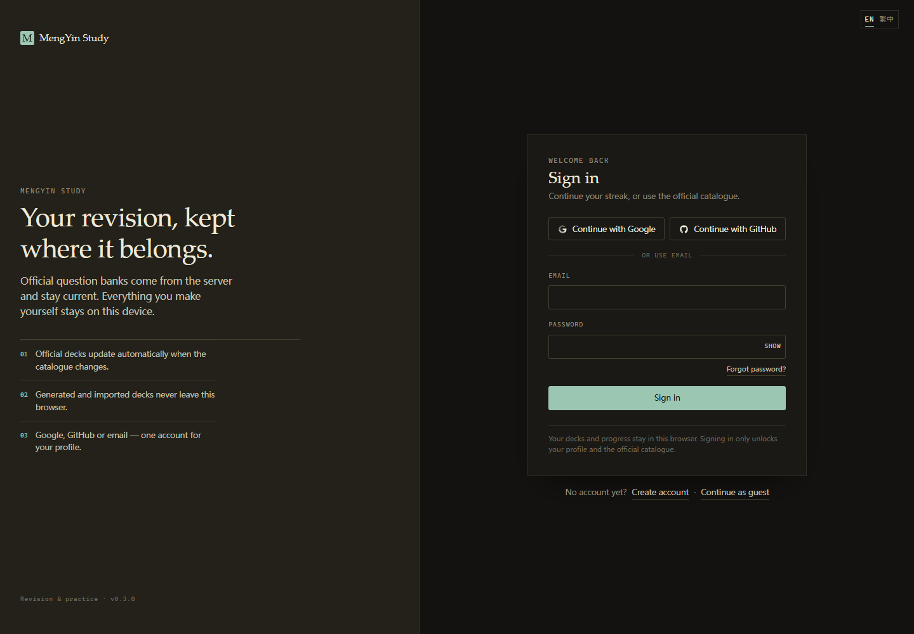

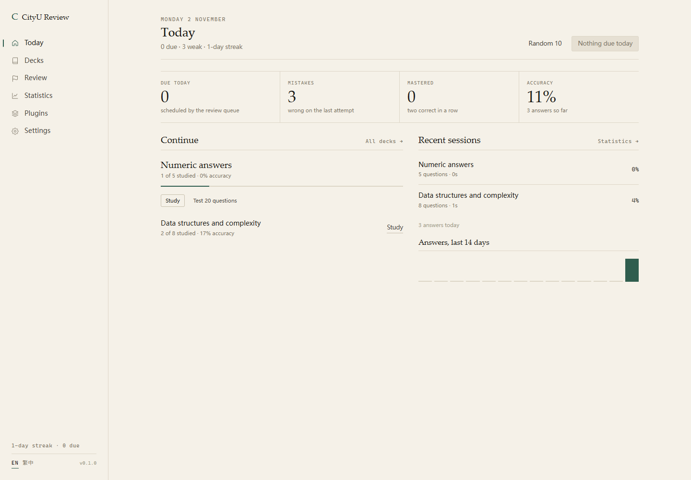

| Decks | Practice | Results |
| --- | --- | --- |
| 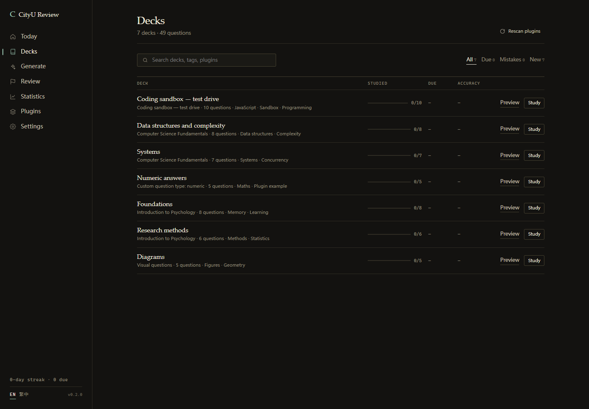 | 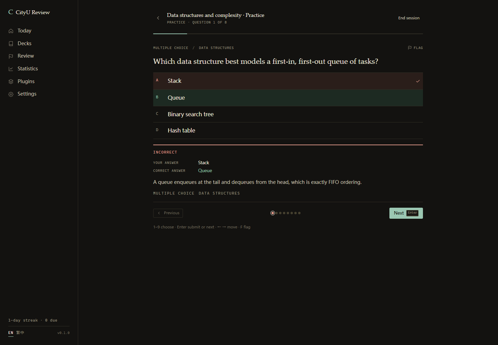 | 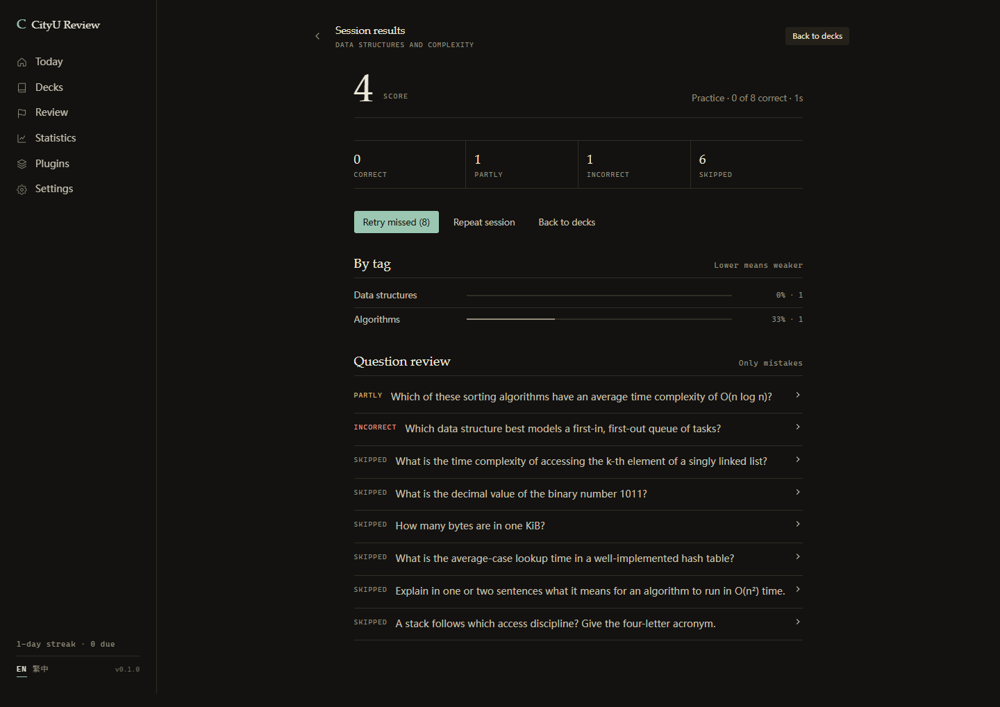 |

| Statistics | Plugins | 繁體中文 |
| --- | --- | --- |
| 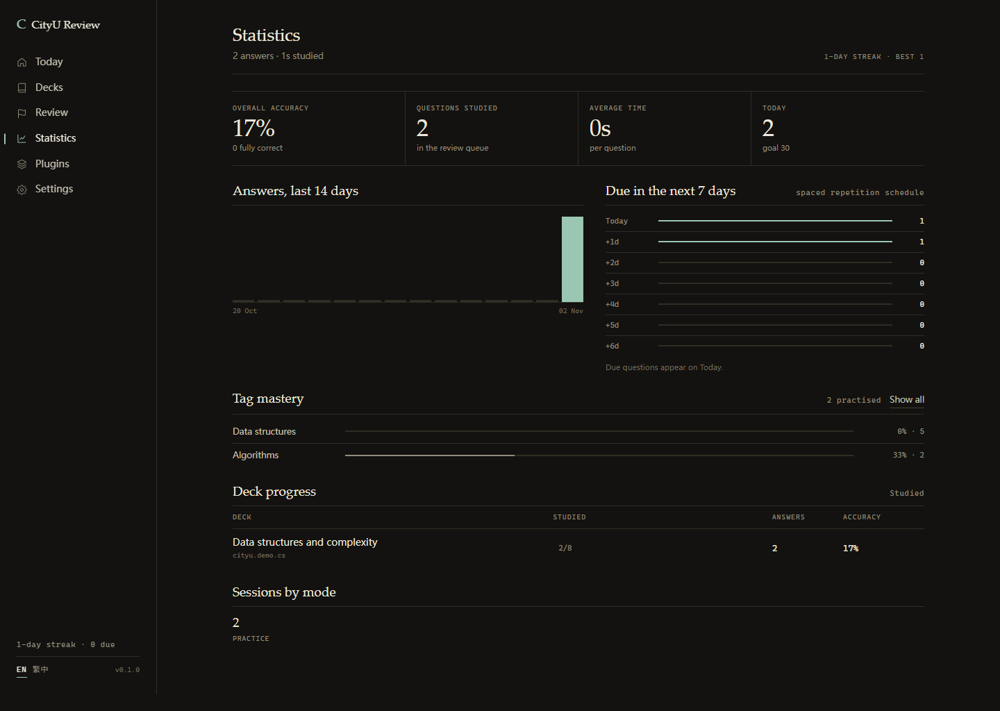 | 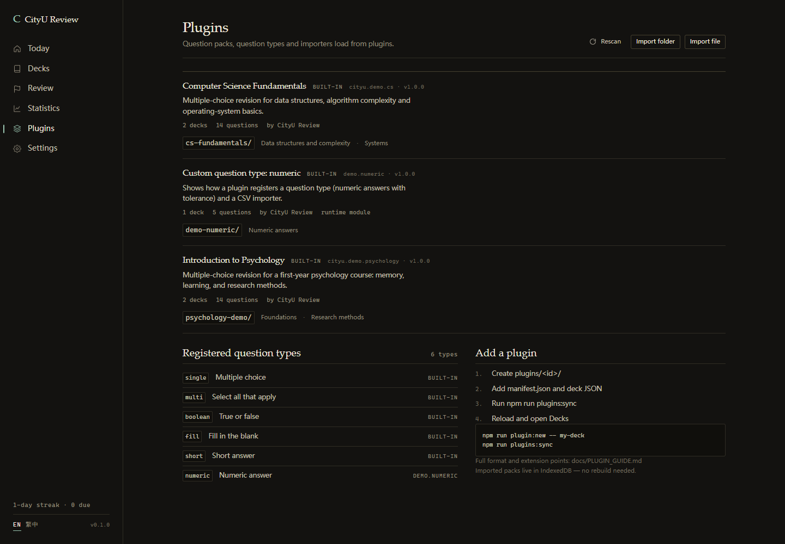 | 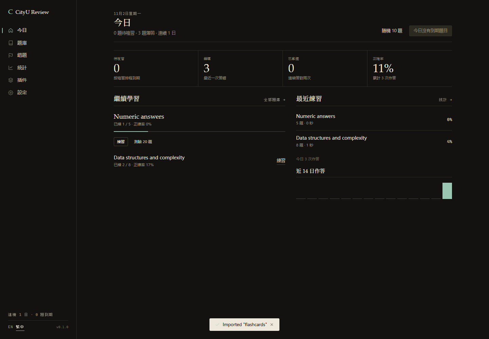 |

| Generate from your material | Code question, run in practice | Exam stays answer-only |
| --- | --- | --- |
| 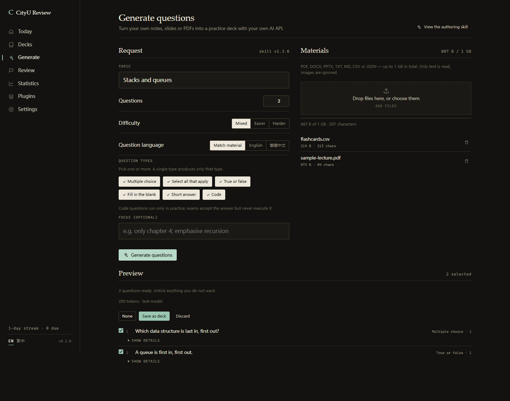 | 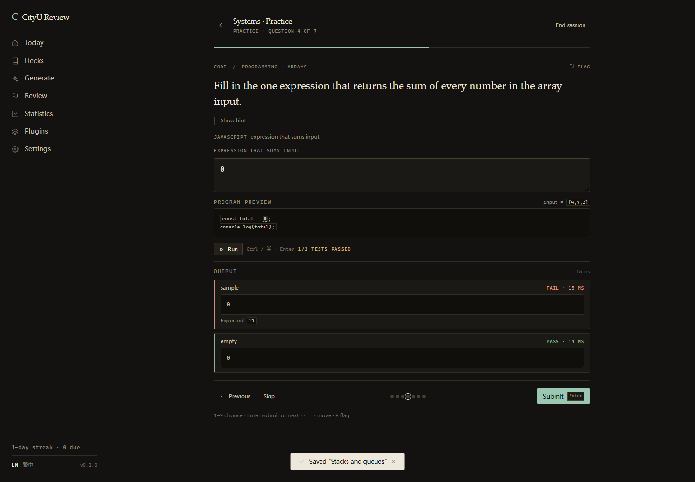 | 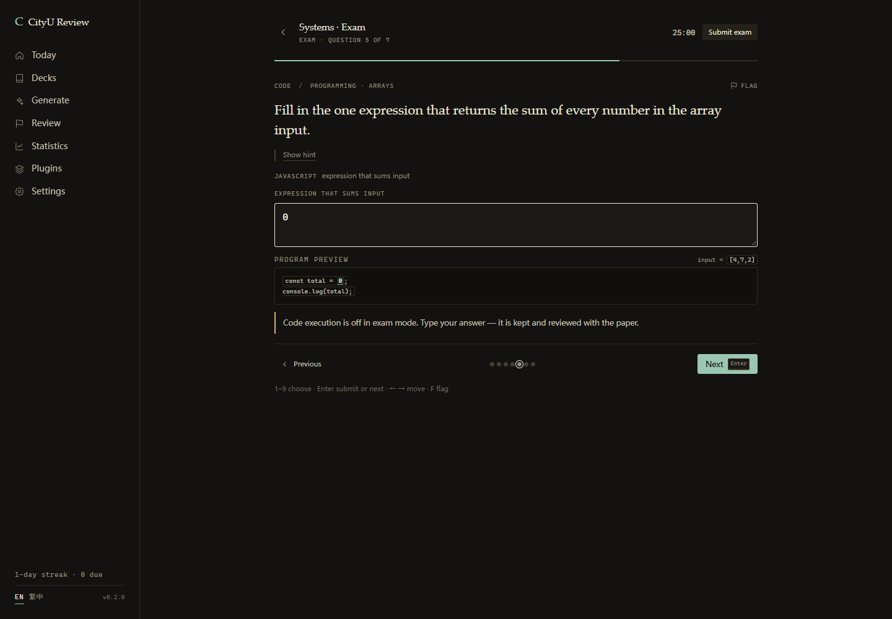 |

Dark mode: [dashboard-dark.png](docs/screenshots/dashboard-dark.png).

## Design direction

The first version looked like generated SaaS: purple-to-blue gradients, a marketing hero, glowing
cards, one rounded-rectangle grid after another. It was rebuilt around a deliberately editorial
point of view instead — warm paper (`#F5F1E8`), ink type, a single pine accent, serif headings,
1 px rules instead of shadows, tabular numbers, and dense list/table layouts.

The rules applied are the usual anti-slop checklist: no purple gradients, no emoji as icons, no
hero section, no identical card grids, no decorative sparklines. References consulted:

- [Anti-AI-Slop Rules](https://github.com/freekmurze/dotfiles/blob/fe89482ce432f76e750885c4cdb29f88155c4cb7/config/claude/skills/swiftui-design/references/anti-ai-slop.md)
  — banned patterns and what to do instead
- [AI Slop Detection](https://github.com/aladicf/better-web-ui/blob/HEAD/skills/frontend-design/reference/ai-slop-detection.md)
  — hierarchy before decoration, fewer but intentional effects
- Product references for structure rather than surface: Anki (dense, keyboard-first, no chrome),
  Brainscape (confidence-first review loop), Readwise/Reader (warm paper + serif), Linear (1 px
  borders, mono micro-labels), Quizlet (clean deck → learn → test flow).

## Quick start

Requires Node.js 20.19+ (developed on 24).

```bash
npm install
cp .env.example .env   # Supabase URL + publishable key (already filled for this project)
npm run dev            # API on :8787 + web on http://127.0.0.1:5173
```

```bash
npm run build      # apps/web/dist, plugins included
npm run preview    # http://127.0.0.1:4173
```

The app runs and the bundled decks work without a server. Accounts and the live official catalogue
need the schema from [`supabase/migrations/`](supabase/migrations) and at least one seed run — see
[Backend setup](#backend-setup) and [docs/BACKEND.md](docs/BACKEND.md).

## Study modes

Open a deck and choose how to work through it:

| Mode | Behaviour |
| --- | --- |
| Practice | Immediate feedback with explanations, self-paced. |
| Muscle memory | Fast rounds: the answer is shown for 2 seconds, then the next question appears. A missed question goes back to the end of the queue (up to 3 returns per question). |
| Exam | Countdown set by the deck (official content or AI generation; otherwise estimated from the questions). Answers stay editable — move with **Next**/**Previous** or jump with the dots — until **Submit exam**; the last question's button reads **Submit**. Nothing on screen reveals correctness before you submit. |
| Spaced review | Only questions the SM-2 schedule says are due today. |
| Mistakes | Only questions you got wrong on the last attempt. |

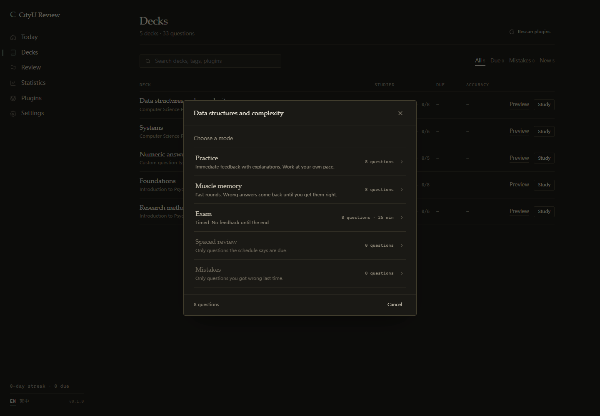

Multi-select questions say so explicitly and use checkboxes, so it is clear that more than one
answer can be chosen:

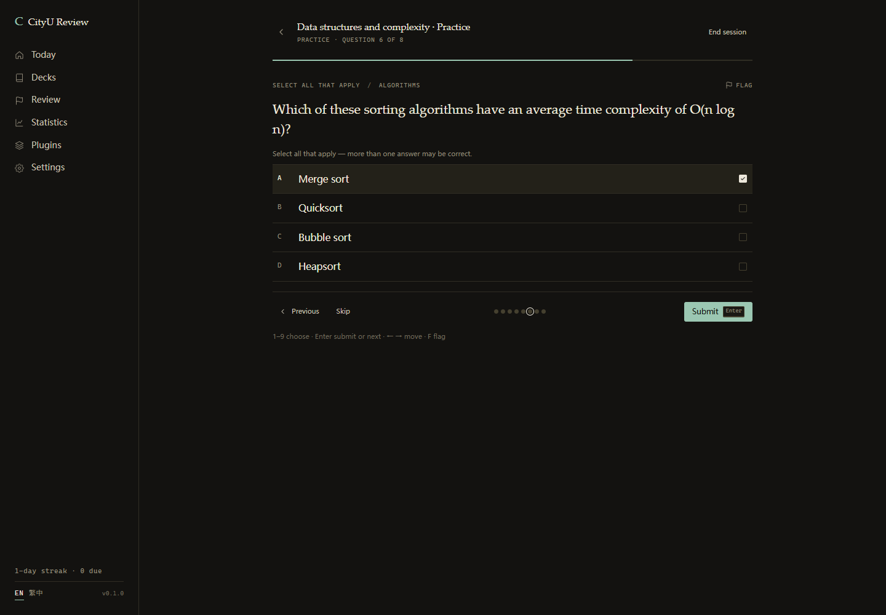

A question can also carry a figure, and each option can have its own image. Paths such as
`./assets/chart.svg` resolve against the plugin folder:

| Figure in the prompt | Images inside options |
| --- | --- |
| 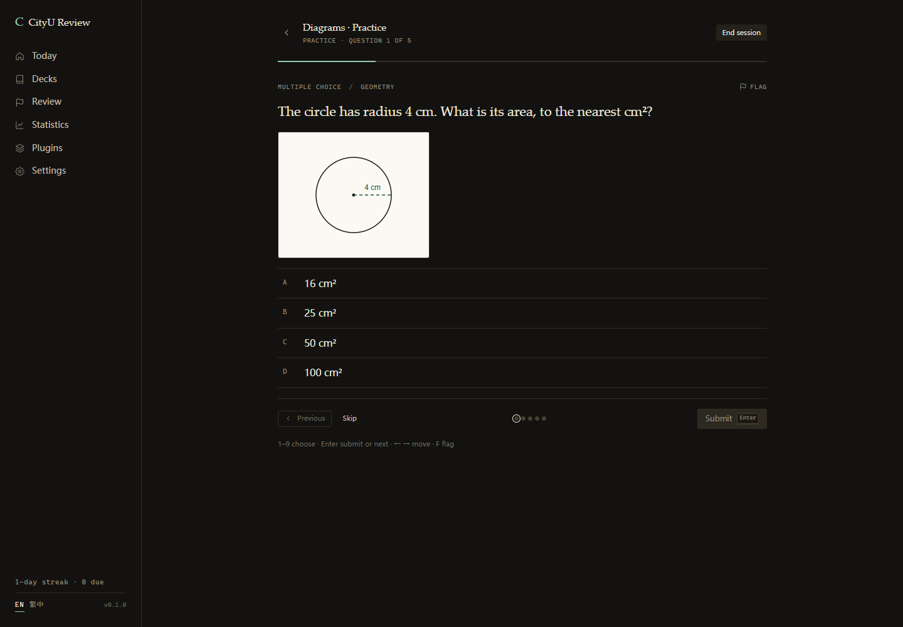 | 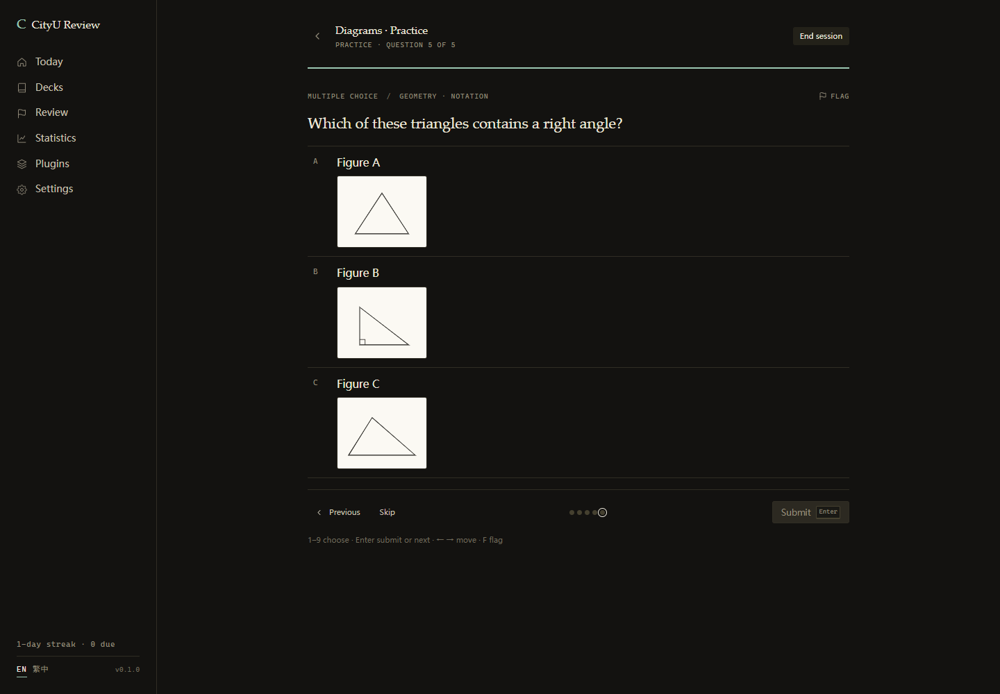 |

## Accounts and the official question bank

The content model splits content into two deliberately separate worlds:

| Content | Stored | Updates |
| --- | --- | --- |
| **Official packs** | Supabase Postgres + Storage | Plaza lists them; a catalogue version change refreshes the questions |
| **Bundled snapshot** | `plugins/` in the build | Offline/first-run fallback; the Plaza itself needs the backend to list official decks |
| **Added official decks** | `user_official_decks` reference (owner-only) | Appear in Decks after **Add to my decks**; official updates follow the catalogue |
| **Generated decks** | Supabase `user_decks` (owner-only) + per-account IndexedDB cache | Sign-in required; uploads automatically; loaded from the server on sign-in/focus |
| **Imported decks** | This browser's IndexedDB, then `user_decks` automatically | Uploaded in the background after sign-in |
| **Private cloud decks** | Supabase `user_decks` (owner-only) | Visible on every signed-in device; signed out, generated decks are hidden |
| **Collections** | Supabase `user_collections` (owner-only) + per-account IndexedDB cache | Group any library decks; edits sync automatically and are readable on every signed-in device |
| **Guest starter decks** | Bundled in the app | Always available without an account |
| **Progress, notes, flags** | Supabase `user_progress` (owner-only) + a per-account IndexedDB cache | Live sync: local changes upload automatically and other devices update through Realtime; JSON export/import remains as a manual backup |

Sign in from the account chip in the sidebar (or `#/login`). The complete flow is implemented:

- create an account with email, password and display name;
- confirm the email (resend available) or sign in immediately if confirmation is disabled;
- Google and GitHub OAuth with PKCE;
- forgot-password email and a reset screen;
- edit display name, see role and provider, sign out;
- a protected `#/account` route and a catalogue status panel.

The browser only holds the **publishable** key. Official content is public-read; official writes are
restricted by RLS to admins, and `profiles.role` is not in the authenticated update grant and is
guarded by a trigger. Each `user_decks` row, `user_official_decks` reference and `user_collections`
row is readable only by its owner. See the policy matrix in [docs/BACKEND.md](docs/BACKEND.md#2-permission-model).

### Backend setup

```bash
# 1. Apply the seven migrations — pick one:
supabase link --project-ref yukmxeieklwgnwdcqwpb && supabase db push
# or, without the CLI/Docker, paste the SQL files in the Supabase SQL editor
# or use the direct connection: SUPABASE_DB_PASSWORD=... npm run db:migrate

# 2. Configure Google/GitHub providers and redirect URLs in Supabase Auth
#    http://127.0.0.1:5173/** and http://127.0.0.1:4173/**

# 3. Seed the official catalogue with SUPABASE_SECRET_KEY in .env.local
npm run seed:official

# 4. Verify the public (publishable-key) read path
npm run backend:check
```

The seed script is also the content update path: edit `plugins/` or use Supabase Studio, then run
`npm run seed:official -- --pack=<id>`; the version trigger makes every client refresh on its next
check. Details, admin bootstrap and the full policy matrix: [docs/BACKEND.md](docs/BACKEND.md).

To sell subscriptions, create the Stripe products/prices, webhook and secrets described in
[docs/STRIPE_SETUP.md](docs/STRIPE_SETUP.md); `npm run stripe:check` verifies the six price ids
before you open Checkout.

## AI-generated decks

**Generate** turns your material into a practice deck through the hosted AI API. You do not enter a
provider key: the Worker holds the official GLM and DeepSeek keys and forwards only the request.

1. **Generate → Generation engine** lists the providers, text models and image models the server has
   configured. Choose Automatic, or pick a provider, model and image model, and choose whether
   visuals are off, automatic or wanted for every question. There is no per-deck visual cap;
   Generate more can keep adding questions and pictures. Changes save immediately and apply to the
   next generation; no key is involved.
2. **Generate**: add material (`.pdf`, `.docx`, `.pptx`, `.txt`, `.md`, `.csv`, `.json`) — up to
   **1 GB** in total. Only text is read; images are never decoded, which is what makes a
   picture-heavy PDF workable. Scanned PDFs without a text layer are rejected (no OCR). Extracted
   text is capped at 8 M characters per file and 32 M in total, and the material row marks truncated files.
3. Pick a topic, any number of questions, difficulty, language, and **one or more question types** (multiple
   choice, multi-select, true/false, fill, short answer, code). Selecting a single type produces only
   that type; selecting several mixes them.
   **No file is required**: write a description (the first line can double as the topic) and generate
   from that. A short text file such as `1.txt` containing `C++ coding` is accepted, and a short
   heading is handled as a **topic brief**: the model uses general knowledge instead of refusing to
   invent facts.
4. The browser sends a bounded, topic-ranked extract (up to 300k characters) to `POST /api/ai/questions`
   and reads progress over server-sent events. The Worker chunks the material, asks for at most six
   questions per call, validates every reply with the same schema as a plugin deck, removes duplicates,
   and halves a batch that hit the provider's output limit. Exact diagrams arrive as `figure` specs and
   are drawn locally; photo briefs are rewritten from the finished question, rendered with Cloudflare
   Workers AI (free allocation), checked by a vision model when one is configured, and signed so the
   bytes cannot be swapped later.
5. Review the result, untick anything you do not want, and save it as a deck. Saving requires sign-in.

Saving a generated deck uploads the deck JSON — figure specs included, photos moved to private
Storage — to your private `user_decks` rows. It is cached in IndexedDB per account so offline use
still works. While signed out, generated decks are hidden; the bundled guest starter decks remain
available. Material text is deleted from the device as soon as generation finishes and is never
stored on the server.

A saved generated deck stays editable: in **Decks**, use the pencil on its row (or **Edit deck** in
the preview) to rename it and remove questions you no longer want. Kept questions keep their ids, so
their practice history stays attached; the edit is written to the cloud copy and the local cache
together.

The authoring prompt lives in `apps/api/src/generation/skill.ts`. It is bundled only into the Worker,
never into the web app, and provider keys are Worker secrets. The app never trusts the model — invalid
questions are dropped and reported.

Setup, keys and API details: [docs/AI_GENERATION.md](docs/AI_GENERATION.md) and
[docs/AI_API.md](docs/AI_API.md).

## Code questions

A code question is a program with one or more blanks, written in JavaScript, TypeScript, Python,
SQL, Java or C++. Three shapes are supported:

- **Single blank** — one `{{blank}}` for an expression or statement:

  ```js
  const total = {{blank}};
  console.log(total);
  ```

- **Multiple blanks** — 2–6 named `{{blank:name}}` markers, each with its own input and label. This
  is aimed at things like the six parts of two nested `for` headers:

  ```js
  for ({{blank:iInit}}; {{blank:iCond}}; {{blank:iStep}}) {
    for ({{blank:jInit}}; {{blank:jCond}}; {{blank:jStep}}) { … }
  }
  ```

- **Whole body** — `layout: "body"` with one large blank. The question supplies the signature and
  braces; the learner writes the entire body of `main()` (or any function), not just one line:

  ```js
  function main() {
    {{blank}}
  }
  main();
  ```

- In **practice-type sessions**, **Run** executes each test in a sandboxed worker and shows the
  stdout per case. The preview shows the first test's supplied `setup`/`input`/`stdin` above the
  blank, so variables such as `input` are visible while writing the answer. Submitting reuses the
  recorded run; the verdict comes from matching the output.
- In **Exam**, the Run control is hidden and nothing is executed: the answer is stored and marked as
  skipped on submission, with the model solution shown in the review. This is enforced in the UI and
  in `finishExam()`.
- The sandbox is a worker inside a `sandbox="allow-scripts"` iframe with `default-src 'none'`, no
  network, no DOM, no storage, and a per-test timeout (3 s default). Runaway loops are terminated
  without freezing the app. It is a study aid, not a hostile-code security boundary.
- **Languages:** JavaScript and TypeScript run on the browser engine; TypeScript types are stripped
  with Sucrase. Python runs on Pyodide, SQL on sql.js (SQLite) and Java on javac + TeaVM, all
  WebAssembly and all served from the app's own static folder. C++ runs on the JSCPP interpreter.
  `npm run runtimes:fetch` copies or builds them before dev/build, so the deployed site needs no
  execution server or third-party CDN. The runtime downloads once (Python ≈12 MB, Java ≈8 MB, SQL
  ≈0.7 MB, C++ ≈0.4 MB) and is then browser-cached. SQL tests put schema and rows in a SQL `input`
  string and print `SELECT` results as `a | b` rows; Java/C++ tests put their fixture in a `stdin`
  string and print to stdout.
- **Cloudflare Worker:** `apps/web/public/_headers` grants CORS on `/runtimes/*` (the sandbox iframe
  has an opaque origin) and caches the versioned runtime files immutably. The same Worker serves
  `/api/ai/*`. See [docs/DEPLOY_CLOUDFLARE.md](docs/DEPLOY_CLOUDFLARE.md) for the build command and
  output directory.

| Six named blanks, two nested loops | A whole `main()` body |
| --- | --- |
| 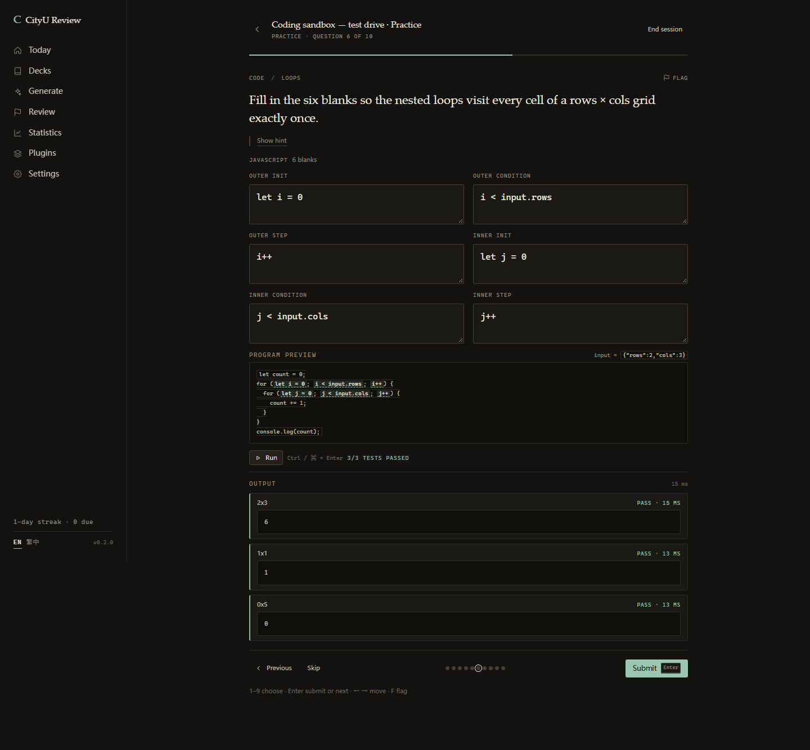 | 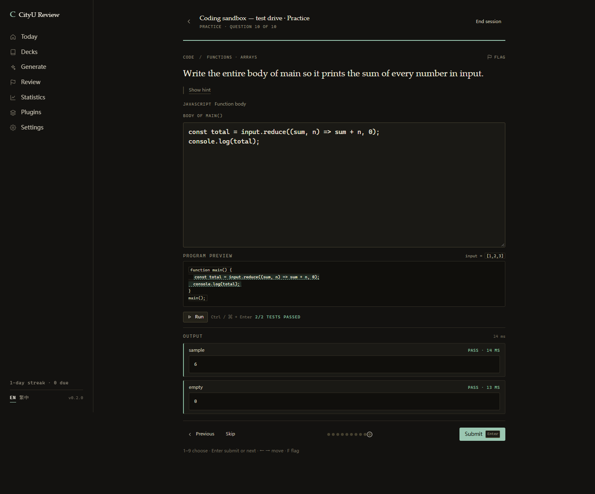 |

## Privacy policy and terms

The app publishes its own legal documents. `/privacy/` and `/terms/` are standalone HTML files
emitted at build time — no bundle, no login, readable with JavaScript disabled — which is what an
app store needs in those two URL fields. `#/privacy` and `#/terms` render the same text inside the
app, linked from Settings → About and every sign-in screen; creating an account requires ticking a
consent checkbox. Wording lives in
[`apps/web/src/legal/content.ts`](apps/web/src/legal/content.ts), available in Traditional Chinese
and English; see [docs/LEGAL.md](docs/LEGAL.md) for the store checklist and the environment
variables that set the operator name and contact mailbox. Google OAuth verification has its own
Console checklist in [docs/OAUTH_VERIFICATION.md](docs/OAUTH_VERIFICATION.md): use
`https://study.mengyin.online/privacy/`, not the `#/privacy` hash route.

## Desktop app

```bash
npm run desktop    # build, then open the Electron window
```

The shell serves `apps/web/dist` from a loopback-only HTTP server instead of `file://`, so `fetch`,
dynamic `import()` of plugin modules and the service worker behave exactly as in the browser.

The desktop shell has no API server of its own. Set `VITE_AI_API_BASE` to the deployed Worker URL
before `npm run desktop`; the Worker's `ALLOWED_ORIGINS=*` setting allows the loopback origin. Without
it, practice works but AI generation reports that the service is unavailable.

If npm blocks Electron's download script: `npm install-scripts approve electron`, then
`node node_modules/electron/install.js`. Without Electron you can still install the PWA from
`npm run preview`.

## Project layout

```
mengyin-study/
├─ apps/
│  ├─ web/                    React 19 + Vite
│  │  ├─ src/
│  │  │  ├─ i18n/             messages (en + zh-Hant) and translator
│  │  │  ├─ legal/            privacy policy and terms: bilingual content + static renderer
│  │  │  ├─ components/       question card, code answer, verdict, results, UI primitives
│  │  │  ├─ domain/           plugin registry, answer adapters, deck views, grading
│  │  │  ├─ pages/            Today, Decks, Plaza, Generate, Practice, Review, Statistics, Plugins, Settings
│  │  │  ├─ ai/               API client, materials, chunking and request packing
│  │  │  ├─ sandbox/          code runner (JS worker; Python/SQL/Java/C++ runtimes in a sandboxed iframe)
│  │  │  ├─ services/         data-service contracts, Supabase impl, catalogue cache/sync
│  │  │  ├─ state/            AppContext, AuthContext, OfficialContentContext
│  │  │  ├─ lib/              router, IndexedDB, formatting, theme
│  │  │  └─ styles/           design tokens (base.css) and layout (app.css)
│  │  └─ public/              icons, manifest, service worker
│  ├─ api/                    Cloudflare Worker: providers, generation prompt, images, auth, quotas
│  └─ desktop/                Electron shell (main.cjs + preload.cjs)
├─ packages/
│  ├─ ai-contract/            wire types shared by the web client and the Worker
│  ├─ core/                   framework-free domain: types, grading, SM-2, sessions, stats
│  └─ plugin-sdk/             plugin contract: zod schemas, registries, loader
├─ plugins/                   official content sources (decks + optional feature module)
├─ supabase/                  migrations, local config, backend README
├─ tools/                     sync, scaffold, backend seed/check, local API, headless verification
└─ docs/                      plugin guide, architecture, backend/RLS, AI API, Stripe setup, legal and Cloudflare guides
```

## Commands

| Command | What it does |
| --- | --- |
| `npm run dev` | start the AI API (8787) and Vite (5173) together |
| `npm run dev:web` | start only Vite; it proxies `/api` to 127.0.0.1:8787 |
| `npm run dev:api` | run the Worker API locally with Node; demo provider when no key is set |
| `npm run build` | sync plugins, build the web app and Worker assets to `apps/web/dist` |
| `npm run deploy` | build, then `wrangler deploy` the Worker and static assets |
| `npm run preview` | preview the build on 127.0.0.1:4173 |
| `npm run plugins:sync` | copy `plugins/` to `apps/web/public/plugins` + write `index.json` |
| `npm run runtimes:fetch` | copy Pyodide + sql.js into `apps/web/public/runtimes/` (also runs before dev/build) |
| `npm run plugins:watch` | same, on file changes |
| `npm run plugin:new -- my-deck` | scaffold a plugin folder with sample questions |
| `npm test` | Vitest unit tests (424) |
| `npm run typecheck` | TypeScript across all workspaces |
| `npm run check` | typecheck + test + build |
| `npm run backend:check` | publishable-key check of auth, catalogue version and counts |
| `npm run db:migrate` | apply `supabase/migrations/*.sql` over a direct Postgres connection |
| `npm run seed:official` | publish `plugins/` into Supabase (secret key) |
| `npm run desktop` | build, then launch Electron |
| `npm run serve:dist` | static server for the build |
| `npm run verify:browser` | legacy 55-step smoke test; expects the archived demo fixtures |

## Write a deck in five minutes

```bash
npm run plugin:new -- organic-chemistry
npm run plugins:sync
```

`plugins/organic-chemistry/manifest.json`:

```json
{
  "schemaVersion": 1,
  "id": "organic-chemistry",
  "name": "Organic Chemistry",
  "version": "1.0.0",
  "tags": ["Chemistry"],
  "content": ["./decks/*.json"]
}
```

`plugins/organic-chemistry/decks/basics.json`:

```json
{
  "id": "basics",
  "title": "Functional groups",
  "tags": ["Functional groups"],
  "questions": [
    {
      "id": "fg-1",
      "type": "single",
      "prompt": "Which functional group is present in ethanol?",
      "options": [
        { "id": "a", "text": "Carboxylic acid" },
        { "id": "b", "text": "Hydroxyl" },
        { "id": "c", "text": "Amine" },
        { "id": "d", "text": "Ester" }
      ],
      "answer": { "kind": "single", "optionId": "b" },
      "explanation": "Ethanol, CH₃CH₂OH, contains an –OH hydroxyl group.",
      "tags": ["Functional groups"],
      "difficulty": 1
    }
  ]
}
```

Reload the page (or press **Rescan plugins**) and the deck appears. You can also drop a plugin
folder on the Plugins page — it is stored in IndexedDB, no rebuild needed.

### Bilingual official decks

Official decks may carry both languages. English stays in the ordinary fields; Traditional Chinese
goes in `i18n`, and the app shows whichever matches the interface language. The same fields work on
deck titles, descriptions, prompts, options, explanations and short-answer models:

```json
{
  "title": "Pointers",
  "titleI18n": { "zh-Hant": "指標" },
  "questions": [
    {
      "id": "ptr-1",
      "type": "single",
      "prompt": "What does * do?",
      "i18n": {
        "prompt": { "zh-Hant": "＊ 的作用是甚麼？" },
        "options": { "a": { "zh-Hant": "解引用" }, "b": { "zh-Hant": "取址" } },
        "explanation": { "zh-Hant": "它會解引用指標。" }
      },
      "options": [
        { "id": "a", "text": "Dereference" },
        { "id": "b", "text": "Take the address" }
      ],
      "answer": { "kind": "single", "optionId": "a" },
      "explanation": "It dereferences the pointer."
    }
  ]
}
```

`fill` questions should list both spellings in `accept`, and `short` questions add
`i18n.model["zh-Hant"]` next to the English `answer.model`. Switching language re-localises the
catalogue and any open practice question, so a partially translated deck falls back to English
rather than showing a blank. See the C++ pack under `plugins/` for a full 44-deck example.

## Starter decks and the Plaza

Two guest starter decks ship inside the app (simple everyday questions and a study-method check).
They need no account and cannot be removed. Official content is separate: `plugins/starter/` is
seeded to Supabase and appears in **Plaza → Add to my decks**; the bundled copy is only the offline
fallback.

AI-generated decks and imported folder/JSON decks upload automatically once you are signed in. A
cloud copy uses the same `pluginId::deckId` key, so progress recorded before the upload still
matches. Relative images from an imported plugin folder are embedded as `data:` URLs; a single-file
`index.js` can travel with the deck as an optional runtime module (it runs on every signed-in device,
so only upload code you trust). A cloud copy replaces the local copy in the deck list. Removing a
deck from **Decks** or **Plugins** deletes its cloud row and local copy; an official deck is removed
from your library only, not from the catalogue.

Progress syncs by itself. While signed in, a change is pushed after a short pause and every other
open device receives it through Supabase Realtime, then merges it. Attempts and sessions are unioned
by id; scheduling keeps the newest review; flags and notes carry per-question timestamps so a deletion
on one device is not resurrected by another. Pulling also happens on focus, on reconnect and every
20 seconds as a fallback if the socket drops. Settings shows **Up to date**, **Syncing…** or a retry
message and has a **Sync now** button.

Conflicts are settled by merging, not by timestamped whole-record replacement. A deliberate
**Reset progress** or **Import backup** bumps an epoch, which is the one case that replaces every
device's record; without that, a reset would be merged back to life by an offline device. Theme and
language stay local to each device, while the learning record follows the account. JSON export/import
in Settings remains available as a manual backup independent of the live row.

## Verification

```bash
npm run check          # typecheck + 424 unit tests + build
npm run backend:check  # auth + catalogue version + published counts
npm run serve:dist     # in another terminal
```

Latest run: typecheck clean, **424/424** tests, build OK (main JS **207.20 KB / 48.56 KB gzip**, CSS
**67.83 KB / 11.70 KB gzip**, lazy pdf.js chunk 414.93 KB / 123.17 KB gzip + 1.2 MB worker; the
TypeScript transpiler is a separate lazy **992.70 KB / 293.30 KB gzip** chunk, loaded only when a
TypeScript question runs). A headless browser run verified guest starter decks, guest progress
surviving sign-in, Plaza add/remove, automatic cloud upload of an imported deck, cloud deletion, and
the sign-in gates on Generate and Settings. A targeted code-question run verified that a body-layout
question displays `const input = [...]` above the template and that the filled body passes its test,
and a production-build run verified JavaScript, TypeScript, Python, SQL, Java and C++ code questions
end to end against `npm run serve:dist` (including the runtime CORS headers, Java stdin and the
JSCPP interpreter). A second browser
run verified per-identity statistics: signing out zeroes the dashboard and Recent practice, signing
back in restores that account's 3 attempts and session, a reload keeps them, a newly created account
adopts guest practice without seeing the first account's history, signing into an existing account
leaves guest practice in place, and the legacy `progress:v1` record is claimed once. A two-context
live-sync run then verified that a second sign-in receives the first
device's attempt, that an answer on either device appears on the other without a reload, that
**Reset progress** clears both devices through the epoch, and that signing out shows zero while
signing back in restores the cloud record. Additional browser checks verified that a generated local
deck is hidden while signed out (an imported local deck remains visible), and that a `1.txt`
containing only `C++ coding` produces 10 questions from a mock provider in two 5-question batches.

`npm run verify:browser` is the older 55-step suite; it still references the archived demo packs
(`.tmp/removed-plugins-20261103/`), so run it only after restoring those fixtures. The current
backend check reports:

```text
[backend] auth: ok
[backend] providers: email=true google=false github=false
[backend] official catalogue: v5
[backend] published packs: 1
[backend] published decks: 1
```

Google/GitHub still need their OAuth apps enabled in the Supabase dashboard.

## Notes and known limits

- Electron is wired up but could not be opened in the environment this was built in (no interactive
  desktop). If `npm run desktop` does nothing, check `ELECTRON_RUN_AS_NODE` is not set.
- Exam mode marks everything when you submit. Short-answer questions need self-grading, and code
  questions must not run, so in an exam both count as skipped; the model answer is still shown in the
  results review.
- **Progress is per identity and follows the account.** Guests have a local record; every account has
  an owner-only cloud row. Signing out shows the guest record (normally zero), signing back in restores
  that account's attempts, sessions, mistakes and notes, and another signed-in device receives changes
  through Realtime. Only an account created on this device adopts guest practice once and clears the
  guest record; signing into an existing account leaves guest practice untouched and keeps that
  account's own statistics. The shared `progress:v1` record from earlier versions is claimed by the
  first account that signs in after upgrading.
- **A deleted account does not linger on other devices.** Deleting the account on a phone removes the
  auth user, but the desktop's local token would otherwise stay valid until it expired. Every device
  now re-checks the stored session on boot, on focus and once a minute, and drops the session when
  GoTrue says the account is gone. Offline or server failures never sign anyone out.
- **Merging is field-aware, not last-write-wins.** Attempts and sessions union by id, cards keep the
  newest review, flags/notes use per-question timestamps, and theme/language stay device-local. Only a
  reset or backup import bumps the epoch and replaces other devices, which is intentional.
- **Official additions are references.** Removing an official deck from your library does not delete
  it from the catalogue or from anyone else's library.
- AI generation goes through the hosted Worker, so it needs a network connection and a signed-in
  session. Progress streams over SSE, but a large deck can still take a minute. Materials are
  deleted after a successful generation, so re-generating from the same file means adding it again.
- The code sandbox supports JavaScript, TypeScript, Python, SQL, Java and C++. C++ is the JSCPP
  teaching interpreter, not a full Clang build: `iostream`, `cmath`, arrays, functions, pointers and
  basic classes work, but full STL containers, templates and exceptions do not. Java is javac +
  TeaVM, with a substantial standard library but no threads, files or network. Other languages would
  need another bundled runtime. Scanned PDFs without a text layer are rejected — there is no OCR. A
  picture-heavy PDF is fine because only text is read.
- No installer packaging (electron-builder) yet.
- Accounts, the official catalogue, **generated and imported cloud decks** and **live progress** use
  Supabase. A cloud deck and the progress row are private to the account that owns them — do not treat
  either as a shareable link. Runtime plugin modules execute on every signed-in device, so only upload
  code you trust. The AI provider key lives only on the server, and uploaded materials are deliberately
  left out of the JSON backup.
- The official catalogue is public-read. It is not a paid-content system; change the read policies
  and clear the local cache on sign-out if it ever needs to be private.
- OAuth in the Electron shell needs a fixed loopback port and that URL registered in Supabase; the
  web build is the supported OAuth target. Email/password works in both.
- There is no admin UI in 0.6.0. Content is published with Supabase Studio, SQL, or
  `npm run seed:official`; there is a complete RLS policy matrix in [docs/BACKEND.md](docs/BACKEND.md).

---

## 中文速覽

以 React 寫成的溫習平台：**英文為主、繁體中文完整支援**（介面右上／左下的 `EN / 繁中` 切換）。

- **0.5.1：考試時間由題庫決定**——官方題庫會公佈自己的整卷時限，AI 出題時由模型為每題估算秒數並
  加總成整卷時間；沒有時限資料的題庫按題型與難度估算，不再所有考試共用一個固定分鐘數
- **0.5.0：學習進度即時同步**——登入後作答、錯題、筆記與排程會自動上傳，其他已登入的裝置透過
  Realtime 即時收到並合併，不需要手動備份／還原；登出只顯示訪客紀錄，登入即取回自己的統計。
  衝突以合併處理（作答聯集、卡片取最新複習、標記／筆記有時間戳），只有「重設進度」或匯入備份會
  以較高 epoch 取代其他裝置
- **0.4.0：廣場 + 自動雲端題庫**——官方題庫是公開目錄，在 **廣場** 瀏覽後按「加入我的題庫」才會進入
  自己的題庫；未登入可瀏覽但不能加入。訪客有兩組內建入門題庫；在這部裝置新開的帳戶會繼承訪客的作答、
  錯題與統計，登入既有帳戶則保留該帳戶自己的紀錄，不會混入訪客練習
- **官方題庫會自動更新**：資料庫目錄版本一變，App 下次檢查（開機、回到視窗、每 15 分鐘或按「檢查更新」）
  就會下載、驗證並快取；已加入的題庫會跟隨最新題目內容
- **生成與匯入的題庫全自動上傳**到私人帳戶，不需要按「上傳」；登入後可在其他裝置看到。未登入時生成的
  題庫會隱藏，匯入的題庫仍可本機使用
- **插件只負責功能**：題型、匯入器與執行期 hook；題庫是內容，放在廣場或自己的題庫。程式題是官方功能插件，
  支援 JavaScript、TypeScript、Python、SQL、Java 與 C++；Python、SQL、Java 以 WebAssembly、C++ 以 JSCPP 在瀏覽器本機執行，靜態網站即可運作
- **AI 出題**：內建 GLM 與 DeepSeek 服務（供應商金鑰只在伺服器）。精確圖（函數、幾何、電路、圖表、標註結構）
  由推理模型輸出規格、瀏覽器即時繪製；自然實景才交給生圖模型，並經視覺模型校檢與簽章保護；教材支援
  PDF、DOCX、PPTX、TXT、MD、CSV、JSON，最多 **1 GB**，生成後以同一套 schema 驗證；**生成完成後材料會自動刪除**
- 練習、限時測驗、錯題重溫、間隔重複（SM-2）、標記與筆記
- 未登入不能使用 AI 出題或加入廣場；但仍可練習入門題庫
- 進度、筆記與 AI 偏好存在本機（IndexedDB），可離線使用、可匯出 JSON 備份；題庫自動同步，進度備份則是
  明確的上傳／還原；AI 供應商金鑰不會進入瀏覽器
- 視覺是「編輯／學院風」：暖紙色、襯線標題、細線分隔、密集列表，沒有漸變與發光大卡片

```bash
npm install
cp .env.example .env
npm run dev        # API :8787 + web :5173
npm run desktop    # 桌面視窗
```

官方題庫與帳戶需要先套用 `supabase/migrations/`，再以服務金鑰執行 `npm run seed:official`；
完整設定、RLS 權限表與管理員開通方式見 [docs/BACKEND.md](docs/BACKEND.md)。
